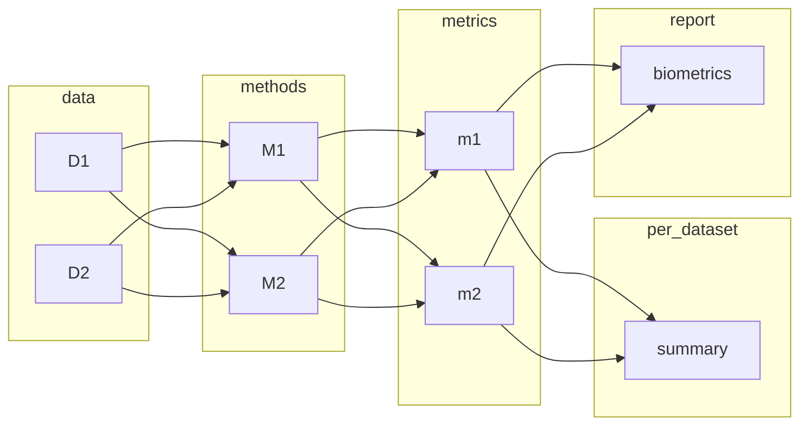

## Design a benchmark YAML

A benchmark is described by one YAML file, the **plan**. It names the
benchmark's components (datasets, methods, metrics), where their code lives,
and how the output of one feeds the next.

This tutorial builds a small benchmark:

- `D1` and `D2` are datasets. (Real datasets have meaningful names, e.g.
  `semisimulation_smith_2019`.)
- `M1` and `M2` are methods. Each runs on every dataset.
- `m1` and `m2` are metrics. Each scores every method result.
- `summary` builds one table per dataset; `biometrics` builds one report for
  the whole run.



A plan has a header and a body.

### Benchmark YAML header

```yaml
## benchmark shortname
id: Benchmark_005

## benchmark description
description: the tutorial benchmark (api 0.8.0); two gather stages

## Benchmark version. This is our first attempt: `1.0`.
version: "1.0"

## Benchmark builder/contact person
benchmarker: "Mary the Benchmarker, mary@uzh.ch"

## Version of the benchmark format this plan is written for (see below)
api_version: "0.8.0"

## How module software is provided. `host` runs in the current environment.
software_backend: host

## The environments modules can run in.
software_environments:
  host:
    description: "the environment ob runs in"
```

The header holds general attributes of the benchmark. The body holds the
components and how they connect.

`host` needs no setup, which suits a tutorial. A real benchmark uses a
reproducible backend (`conda`, `apptainer`, `envmodules`); see
[Software backends](howto.md#software-backends).

### API version

A plan states which version of the benchmark format it is written for:

```yaml
api_version: "0.8.0"
```

The api version fixes the YAML fields a plan may use, the command line its
modules receive, and the layout of the output tree. It is not the version of
the installed `ob`: a newer `ob` still runs plans written for an older api
version.

Declare it explicitly. A plan without `api_version` is read as `0.4.0`, a
legacy contract. New plans should use the latest version, which is what
`ob create benchmark` writes. This tutorial uses `0.8.0`.

Raising the api version of an existing benchmark is a migration: output paths
change and modules may need a new command line. See
[API versions](api-versions.md) for what each version changes and what is
deprecated.

### Benchmark YAML body

The body is a list of **stages**. A stage groups modules that take the same
inputs and produce the same outputs, so that any module of one stage can feed
any module of the next.

Let's start with the first stage, containing `D1` and `D2`. We call it `data`.

```yaml
stages:
    ## the stage id: letters, digits and underscores
  - id: data
    modules:
        ## unique module id: letters, digits and underscores
      - id: D1
        ## module name in a longer form
        name: "Dataset 1"
        ## where it runs; one of the header's `software_environments`
        software_environment: "host"
        ## a git repository and a pinned commit
        repository:
          url: https://github.com/omnibenchmark-example/data.git
          commit: 18257a5
      - id: D2
        name: "Dataset 2"
        software_environment: "host"
        repository:
          url: https://github.com/omnibenchmark-example/data.git
          commit: 18257a5
    ## the files every module of this stage writes
    outputs:
        ## output id: what later stages ask for
      - id: data.counts
        ## file name; `{module.id}` is the id of the module writing it
        path: "{module.id}.txt.gz"
      - id: data.meta
        path: "{module.id}.meta.json"
```

`D1` and `D2` share one repository: the same code produces both datasets, and
receives the module id to tell them apart.

The next stage has inputs as well as outputs.

```yaml
  - id: methods
    modules:
      - id: M1
        software_environment: "host"
        repository:
          url: https://github.com/omnibenchmark-example/method.git
          commit: 3e668e0
      - id: M2
        software_environment: "host"
        ## run M2 twice: with `--e 1` and with `--e 2`
        parameters:
          - e: [1, 2]
        repository:
          url: https://github.com/omnibenchmark-example/method.git
          commit: 3e668e0
    ## output ids of earlier stages
    inputs:
      - data.counts
      - data.meta
    outputs:
      - id: methods.mapping
        path: "{module.id}.model.out.gz"
```

`path` is only a file name. Omnibenchmark decides the directory: each module
run (a **node**) gets one directory, named `stage.module`, inside the
directory of the node it took its inputs from. A node with parameters adds a
short hash of them. So the two stages above write:

```
out/data.D1/D1.txt.gz
out/data.D1/D1.meta.json
out/data.D1/methods.M1/M1.model.out.gz
out/data.D1/methods.M2.9da5174a/M2.model.out.gz     # e = 1
out/data.D1/methods.M2.e44a1eb8/M2.model.out.gz     # e = 2
out/data.D2/...
```

A file's directory is its provenance: `M2.model.out.gz` above was computed by
`M2` with `e = 1` from dataset `D1`. The values behind a hash are in
`parameters.json` next to the outputs, and `out/by-params/` shows the same
tree with readable names (`methods.M2.e-1`).

The metrics stage follows the same pattern:

```yaml
  - id: metrics
    modules:
      - id: m1
        software_environment: "host"
        repository:
          url: https://github.com/omnibenchmark-example/metric.git
          commit: daffdd9
      - id: m2
        software_environment: "host"
        repository:
          url: https://github.com/omnibenchmark-example/metric.git
          commit: daffdd9
    inputs:
      - methods.mapping
      - data.meta
    outputs:
      - id: metrics.scores
        path: "{module.id}.scores.txt"
```

Each metric runs once per method result: 2 datasets × 3 method runs × 2
metrics = 12 nodes, e.g.
`out/data.D1/methods.M2.9da5174a/metrics.m1/m1.scores.txt`. `data.meta` comes
from the dataset each method result descends from.

## Create a module suitable to be used in omnibenchmark

A module is a git repository with a script omnibenchmark can call. Any
repository `git` can clone works: GitHub, GitLab, a local path. The plan pins
each module to a commit; `commit` also accepts a tag or a branch name, but a
branch needs `ob run --unpinned`, since it does not name a fixed version.

`ob create module` scaffolds one (see
[Create a new module](howto.md#create-a-new-module)). Here we read the modules
the plan above uses.

### The entrypoint

The repository of `D1` has an
[`omnibenchmark.yaml`](https://github.com/omnibenchmark-example/data/blob/main/omnibenchmark.yaml)
file naming the script to run:

```yaml
entrypoints:
  default: entrypoint_data.py
```

### What a module receives

Omnibenchmark calls the entrypoint with:

```
<entrypoint> --output_dir <dir> --name <module id> \
    --output <output id>=<path> ...   # one per output of the stage
    --<input id> <path> ...           # one per input of the stage
    --<parameter> <value> ...         # the module's parameters
```

For `D1`, with no inputs and two outputs:

```
entrypoint_data.py --output_dir /abs/out/data.D1 --name D1 \
    --output data.counts=/abs/out/data.D1/D1.txt.gz \
    --output data.meta=/abs/out/data.D1/D1.meta.json
```

The module must write each output to the path it is given. All paths are
absolute. `entrypoint_data.py` reads them with `argparse`:

```python
parser.add_argument('--output', action='append', default=[], help='id=PATH of an output to write')
args, _ = parser.parse_known_args()

outputs = dict(o.split("=", 1) for o in args.output)
# {"data.counts": "/abs/out/data.D1/D1.txt.gz", "data.meta": "/abs/out/data.D1/D1.meta.json"}

for output_id, path in outputs.items():
    create_file(path)
```

Beyond this, the script is free: here it writes files with dummy content.
Writing to the given paths, instead of building file names from `--output_dir`
and `--name`, keeps the module independent of the file names a benchmark
chooses. (`--output_dir` and `--name` are still passed, and are dropped in api
0.10.)

### Inputs and parameters

`M2` takes two inputs and a parameter:

```
entrypoint_method.py --output_dir /abs/out/data.D1/methods.M2.9da5174a --name M2 \
    --output methods.mapping=/abs/.../M2.model.out.gz \
    --data.counts /abs/out/data.D1/D1.txt.gz \
    --data.meta /abs/out/data.D1/D1.meta.json \
    --e 1
```

The flag of an input **is its output id** in the plan: `data.counts` arrives as
`--data.counts`. So the
[script](https://github.com/omnibenchmark-example/method/blob/main/entrypoint_method.py)
declares:

```python
parser.add_argument('--output', action='append', default=[], help='id=PATH of an output to write')
parser.add_argument('--data.counts', type=str, help='optional input file #1.', required=False)
parser.add_argument('--data.meta', type=str, help='input file #2.')

# Anything else on the command line is a method parameter.
args, parameters = parser.parse_known_args()

counts = getattr(args, 'data.counts')
outputs = dict(o.split("=", 1) for o in args.output)
mapping_file = outputs['methods.mapping']
```

Modules can be written in any language. An R module does the same with the
`argparse` package:

```R
parser <- ArgumentParser(description = "Run method on files")
parser$add_argument("--output", action = "append", help = "id=PATH of an output to write")
parser$add_argument("--data.counts", dest = "data_counts", type = "character")
parser$add_argument("--data.meta", dest = "data_meta", type = "character")
args <- parser$parse_known_args()[[1]]
```

## Gather results

So far every node reads the outputs of one upstream node. A summary table or a
report needs many results side by side. A stage with `gather:` runs one module
over many upstream results at once.

We add two such stages: a table per dataset, then one report for the run.

### A gather per dataset

```yaml
  ## One job per dataset, over the scores computed from it.
  - id: per_dataset
    modules:
      - id: summary
        software_environment: "host"
        repository:
          url: https://github.com/omnibenchmark-example/metric-collector.git
          commit: eff6e5f
    gather:
      from: metrics.scores
      group_by: data
    outputs:
      - id: summary_tsv
        path: "summary.tsv"
```

- `from` names an output id, or a list of them. Every node producing it is a
  **member** of the gather; here, the 12 metric nodes.
- `group_by: data` splits the members by the `data` node they descend from, and
  runs one job per group.

So `summary` runs twice: once over the 6 scores below `D1`, once over the 6
below `D2`. Each job writes inside its dataset's directory:

```
out/data.D1/per_dataset.summary-7a8ece18/summary.tsv
out/data.D2/per_dataset.summary-b6d6e298/summary.tsv
```

`group_by` accepts any upstream stage. `group_by: methods` would run one job
per method result (dataset, method and parameters), over its two scores.

A gather with `group_by` may also declare `inputs:`. They resolve from the
group's node or its ancestors, as for any stage below it: `inputs: [data.meta]`
gives each `summary` job the metadata of its own dataset.

### A report for the whole run

Without `group_by`, one job collects every member:

```yaml
  ## One job over every score of the run.
  - id: report
    modules:
      - id: biometrics
        software_environment: "host"
        repository:
          url: https://github.com/omnibenchmark-example/metric-collector.git
          commit: eff6e5f
    gather:
      from: metrics.scores
    outputs:
      - id: report_html
        path: "biometrics_report.html"
      - id: report_tsv
        path: "biometrics.tsv"
```

It has no group to sit in, so it writes at the top of the output tree:

```
out/report.biometrics-4bfefbda/biometrics_report.html
out/report.biometrics-4bfefbda/biometrics.tsv
```

The suffix after the last `-` identifies the set of members. A run that leaves
some members out (for example with `--filter`) writes to a different directory
instead of overwriting the full result. To choose the directory yourself, add
`path:` to the gather (`gather: {from: metrics.scores, path: reports}`); such a
directory has no suffix, so a filtered run overwrites it.

!!! note "Metric collectors"

    Plans below api 0.8.0 collected results with a top-level
    `metric_collectors:` list. api 0.8.0 rejects it: declare a stage with
    `gather:` and no `group_by` instead, as `report` above. See
    [Upgrade a benchmark to api 0.8.0](howto.md#upgrade-a-benchmark-to-api-080).

### A gather module

A gather module receives `--output` and its parameters like any other. Its
members do not come as paths on the command line, since their number is
unbounded. It gets one file listing them:

```
metric_collector.py --output_dir /abs/out/report.biometrics-4bfefbda --name biometrics \
    --output report_html=/abs/.../biometrics_report.html \
    --output report_tsv=/abs/.../biometrics.tsv \
    --from-files /abs/out/report.biometrics-4bfefbda/lineage.json
```

`lineage.json` is written by omnibenchmark next to the gather's outputs. One
member of it:

```json
{"version": 2, "kind": "gather", "stage": "per_dataset", "module": "summary", "node_id": "...",
 "members": [
   {"node_id": "data-D1-methods-M2.9da5174a-metrics-m1",
    "commit": "daffdd9c54d8...",
    "dir": "data.D1/methods.M2.9da5174a/metrics.m1",
    "files": {"metrics.scores": "/abs/out/data.D1/methods.M2.9da5174a/metrics.m1/m1.scores.txt"},
    "lineage": [
      {"node_id": "data-D1", "stage": "data", "module": "D1", "params": null, "parameters": {}},
      {"node_id": "...", "stage": "methods", "module": "M2", "params": "9da5174a", "parameters": {"e": 1}},
      {"node_id": "...", "stage": "metrics", "module": "m1", "params": null, "parameters": {}}]}]}
```

| field | meaning |
|---|---|
| `files` | the member's gathered outputs by output id, absolute paths; a member may contribute several |
| `lineage` | every ancestor from the first stage down to the member itself (the last entry), each with stage, module and parameters |
| `params` | in a lineage entry: short hash of that node's parameters, as in its directory name; null without parameters |
| `parameters` | in a lineage entry: the parameter values behind that hash |

Use `lineage` and `parameters` to label results; do not parse directory names.
The order of members carries no meaning. Reading them takes a few lines:

=== "Python"

    ```python
    import json

    def from_files(path, output_id):
        members = json.load(open(path))["members"]
        return [m["files"][output_id] for m in members if output_id in m["files"]]
    ```

=== "R"

    ```R
    members <- jsonlite::fromJSON(path, simplifyVector = FALSE)$members
    files <- unlist(lapply(members, function(m) m$files[[output_id]]))
    ```

The example
[collector](https://github.com/omnibenchmark-example/metric-collector/blob/master/metric_collector.py)
writes one table row per gathered file, labelled with its lineage.

### Reuse a report module

A report rarely needs benchmark-specific code: it reads the manifest and
renders it. [obcommons](https://omnibenchmark.github.io/obcommons/) is the
community registry of omnibenchmark modules; look there before writing one.

For reports it lists
[omni-quarto-report](https://github.com/omnibenchmark/omni-quarto-report), a
generic gather module that renders a Quarto or R Markdown template over
whatever the gather collected. The template lives in your benchmark's
repository and is passed as a parameter, so the report is yours while the
module is shared:

```yaml
  - id: report
    modules:
      - id: quarto
        software_environment: "quarto"
        repository:
          url: https://github.com/omnibenchmark/omni-quarto-report.git
          commit: 1b90c98
        parameters:
          - template: report.Rmd
    gather:
      from: metrics.scores
    outputs:
      - id: report_html
        path: "report.html"
```

## The full plan

```yaml
id: Benchmark_005
description: the tutorial benchmark (api 0.8.0); two gather stages
version: "1.0"
benchmarker: "Mary the Benchmarker, mary@uzh.ch"
api_version: "0.8.0"
software_backend: host
software_environments:
  host:
    description: "the environment ob runs in"

stages:
  - id: data
    modules:
      - id: D1
        name: "Dataset 1"
        software_environment: "host"
        repository:
          url: https://github.com/omnibenchmark-example/data.git
          commit: 18257a5
      - id: D2
        name: "Dataset 2"
        software_environment: "host"
        repository:
          url: https://github.com/omnibenchmark-example/data.git
          commit: 18257a5
    outputs:
      - id: data.counts
        path: "{module.id}.txt.gz"
      - id: data.meta
        path: "{module.id}.meta.json"

  - id: methods
    modules:
      - id: M1
        software_environment: "host"
        repository:
          url: https://github.com/omnibenchmark-example/method.git
          commit: 3e668e0
      - id: M2
        software_environment: "host"
        parameters:
          - e: [1, 2]
        repository:
          url: https://github.com/omnibenchmark-example/method.git
          commit: 3e668e0
    inputs:
      - data.counts
      - data.meta
    outputs:
      - id: methods.mapping
        path: "{module.id}.model.out.gz"

  - id: metrics
    modules:
      - id: m1
        software_environment: "host"
        repository:
          url: https://github.com/omnibenchmark-example/metric.git
          commit: daffdd9
      - id: m2
        software_environment: "host"
        repository:
          url: https://github.com/omnibenchmark-example/metric.git
          commit: daffdd9
    inputs:
      - methods.mapping
      - data.meta
    outputs:
      - id: metrics.scores
        path: "{module.id}.scores.txt"

  # One job per dataset, over the scores computed from it.
  - id: per_dataset
    modules:
      - id: summary
        software_environment: "host"
        repository:
          url: https://github.com/omnibenchmark-example/metric-collector.git
          commit: eff6e5f
    gather:
      from: metrics.scores
      group_by: data
    outputs:
      - id: summary_tsv
        path: "summary.tsv"

  # One job over every score of the run.
  - id: report
    modules:
      - id: biometrics
        software_environment: "host"
        repository:
          url: https://github.com/omnibenchmark-example/metric-collector.git
          commit: eff6e5f
    gather:
      from: metrics.scores
    outputs:
      - id: report_html
        path: "biometrics_report.html"
      - id: report_tsv
        path: "biometrics.tsv"
```

It is in the repository as
[`tests/data/Benchmark_005.yaml`](https://github.com/omnibenchmark/omnibenchmark/blob/main/tests/data/Benchmark_005.yaml).

## Validate a benchmark YAML

=== "Shell"

    ```shell
    ob validate plan tests/data/Benchmark_005.yaml
    ```

=== "Output"

    ```
    Validating benchmark plan: tests/data/Benchmark_005.yaml
    ✅ Benchmark YAML plan validation passed.
    ```

`ob describe plan` prints the identity of a plan: its `id`, `version`,
`api_version` and a hash of its content.

## Run a benchmark

`--dry` resolves the plan and writes the workflow without running it:

=== "Shell"

    ```shell
    ob run tests/data/Benchmark_005.yaml --dry
    ```

=== "Output"

    ```
    Benchmark YAML file integrity check passed.

    Resolved 8 modules
    Generated 23 rules in 0.0s in out/Snakefile

    Snakefile generated. To execute:
      cd out && snakemake --cores 1
    ```

The methods are fast, so we can run it:

=== "Shell"

    ```shell
    ob run tests/data/Benchmark_005.yaml --cores 2
    ```

=== "Output"

    ```
    Benchmark YAML file integrity check passed.

    Resolved 8 modules
    Generated 23 rules in 0.0s in out/Snakefile
    Running: snakemake --snakefile Snakefile --cores 2 --resources mem_mb=59374
    Log file: out/.logs/snakemake_20261118_104421.log

    Completed 27 jobs successfully

    Benchmark run completed successfully.
    ```

Results are under `out/`, laid out as described above. Running the same
command again does nothing: only missing or outdated results are computed.
Anything after `--` is passed to Snakemake, e.g. `ob run plan.yaml -- --forceall`.

## Run a single module

While developing a module, run only what it needs with `--module`:

=== "Shell"

    ```shell
    ob run tests/data/Benchmark_005.yaml --module M2
    ```

=== "Output"

    ```
    -m M2: single execution path, first param expansion only.
    Benchmark YAML file integrity check passed.
    Module mode: expanding 2 stage(s) (up to and including 'methods'), first expansion only.

    Resolved 4 modules
    Generated 2 rules in 0.0s in out/Snakefile

    Completed 3 jobs successfully
    ```

This runs one chain: the first module of each upstream stage (`D1`), then `M2`
with its first parameter set. Later stages are left out:

```
out/data.D1/D1.meta.json
out/data.D1/D1.txt.gz
out/data.D1/methods.M2.9da5174a/M2.model.out.gz
```

To stop a full run at a stage, or run a chosen subset, see
[`--until`](howto.md#stop-a-run-partway-through-the-benchmark) and
[`--filter`](howto.md#run-a-saved-slice-of-a-benchmark).
